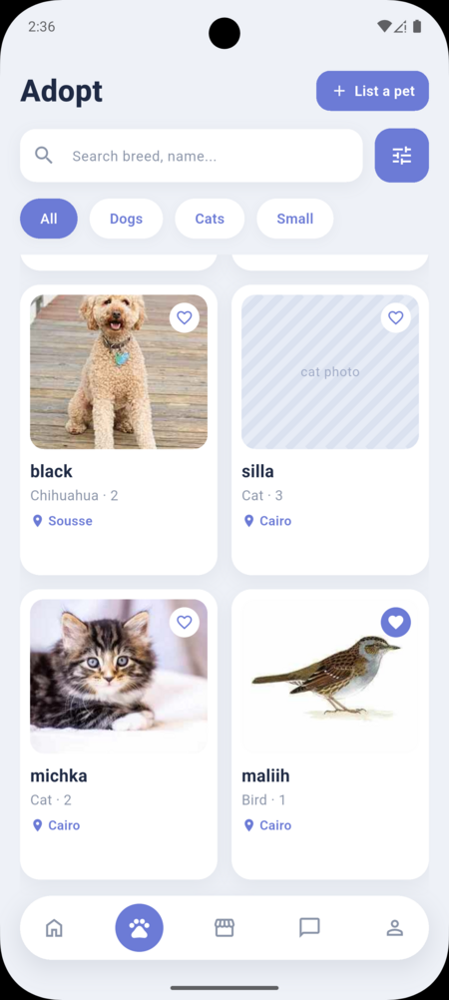
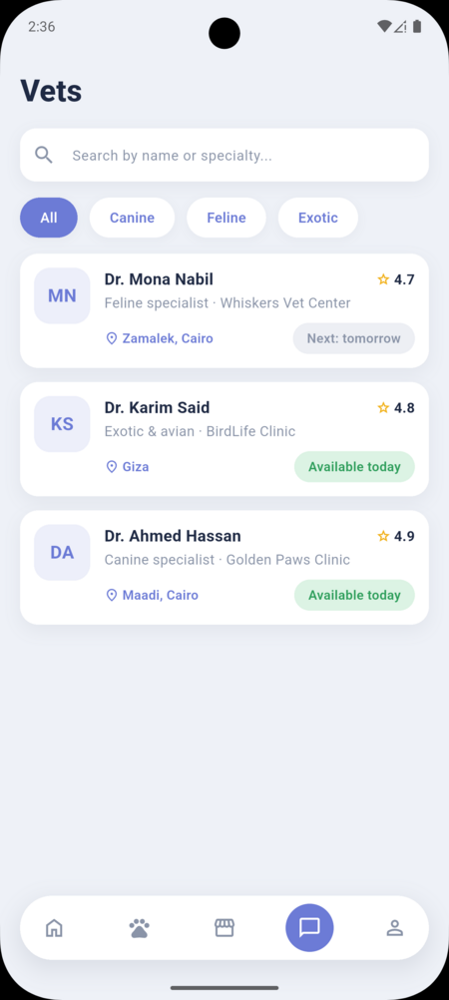
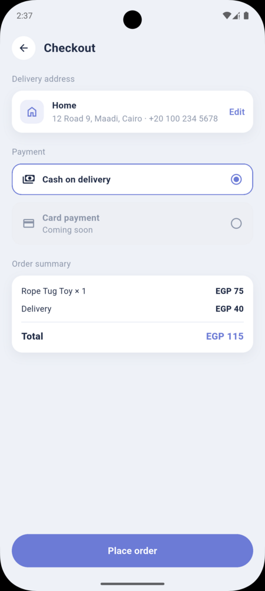

# Adopt Animal 🐾

**Adopt Animal** is a Flutter mobile app that brings the whole pet-care journey into
one place. You can adopt a pet or list your own for adoption, shop for food and
supplies, and consult or book a veterinarian — all in a single, simple app.

Browse a live feed of animals looking for a home, filter and search to find the
right match, and send an adoption request in a couple of taps. Have a pet to
rehome? Post a listing with photos and details, then manage your listings and the
requests that come in. Shop for everything your pet needs, keep the animals you
love in your saved list, and reach a vet by chat, call, or a booked appointment
when you need care.

## Screenshots

  
  &nbsp;&nbsp;
  
  &nbsp;&nbsp;
  

